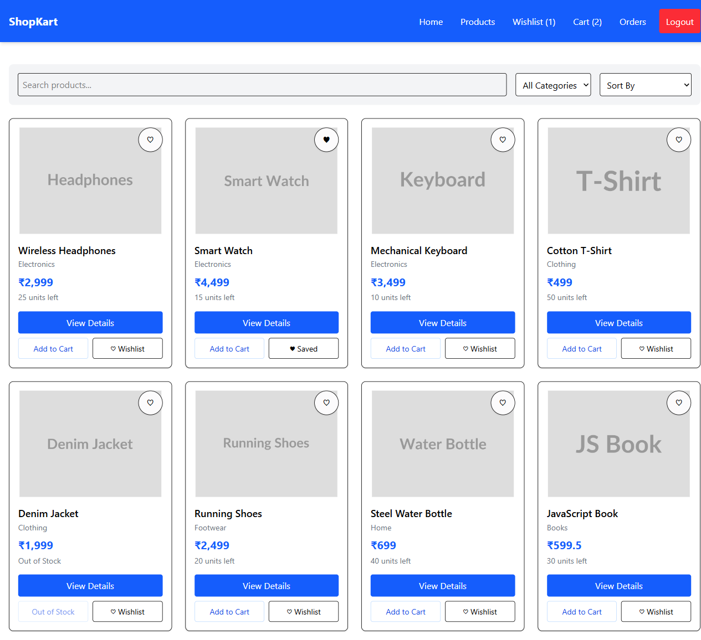
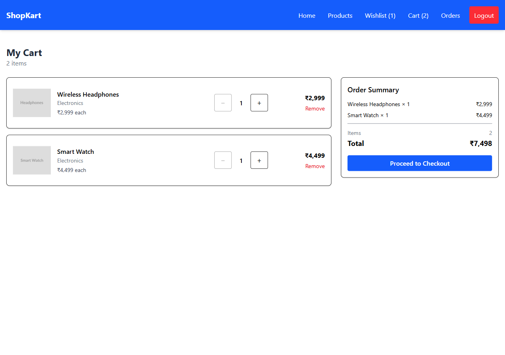
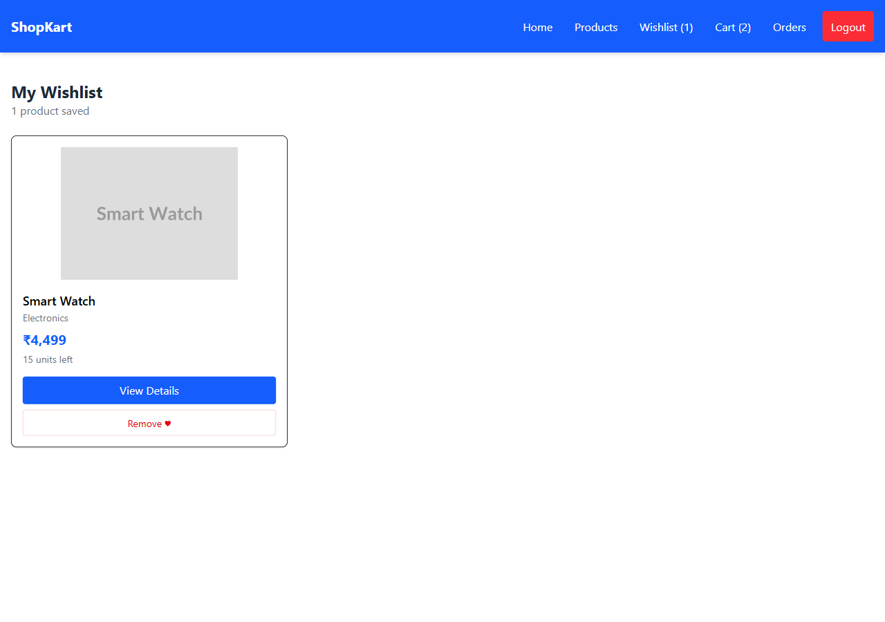
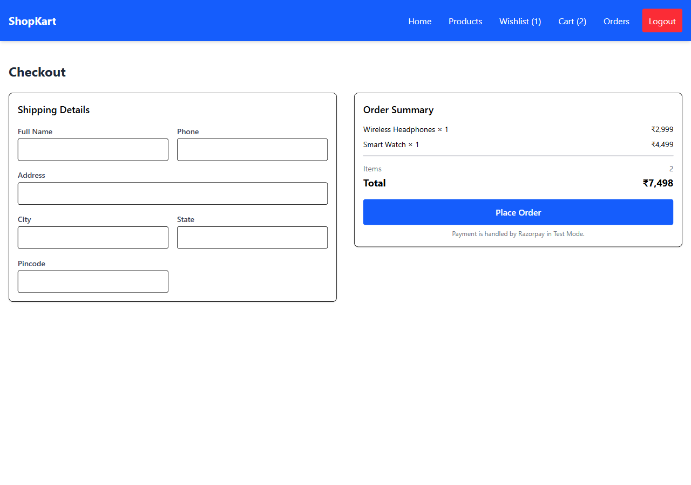
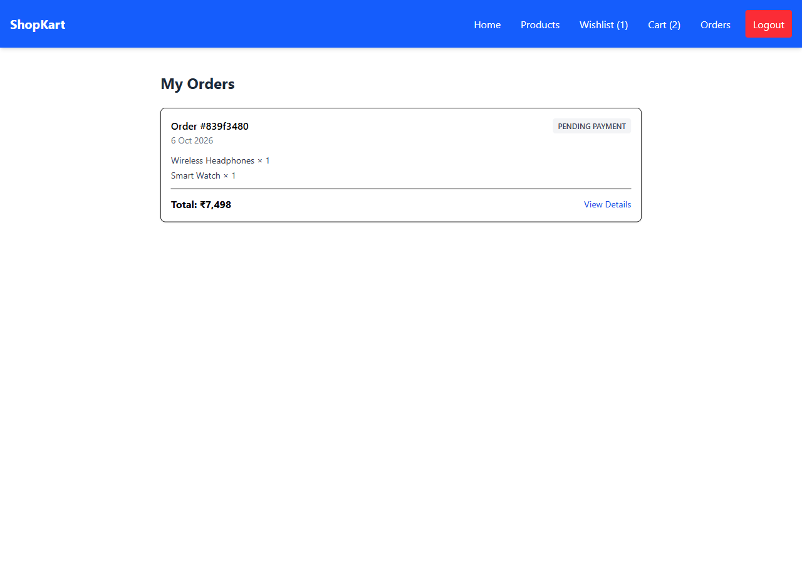

# ShopKart

A full-stack MERN commerce application built across six engineering labs: authentication,
product catalogue, wishlist, cart, checkout with Razorpay, and order history.

**Stack:** MongoDB + Mongoose · Express 5 · React 19 + Vite · Tailwind CSS v4 · JWT in an
HttpOnly cookie · Razorpay (Test Mode) · `node:test` for the API suite.

---

## Screenshots

### Products — search, category filter, sort, wishlist and cart actions


### Cart — quantity controls and a subtotal derived from state


### Wishlist


### Checkout — shipping form with field-level validation


### My Orders


---

## What each lab contributed

| Lab | Feature |
|---|---|
| 01 | Customer registration, login, protected profile, logout. bcrypt hashes, JWT in an HttpOnly cookie. Bonus: change password. |
| 02 | React Register / Login / protected Home, React Router, axios with `withCredentials`. |
| 03 | Product model and APIs, dynamic search and category filtering, product details, loading/error/empty states. Bonus: price sorting. |
| 04 | Wishlist as ObjectId references with `populate()`, duplicate prevention, protected per-customer APIs. Bonus: toggle endpoint and navbar count. |
| 05 | Cart with quantities, stock validation, React Context for shared state, derived subtotal and navbar badge. |
| 06 | Order model with purchase-time snapshots, server-side totals, final stock check, Razorpay order creation, HMAC signature verification, order history. Bonus: order status progression. |

---

## Setup

Requires Node 20+ and a MongoDB connection string (Atlas or local).

```bash
# 1. Backend
cd backend
npm install
cp .env.example .env     # then fill in the values below
npm run dev              # http://localhost:5000

# 2. Frontend, in a second terminal
cd frontend
npm install
npm run dev              # http://localhost:5173
```

`backend/.env`:

```env
PORT=5000
MONGO_URI=your_mongodb_connection_string
JWT_SECRET=any_long_random_string
# Razorpay Test Mode only — the secret must never reach the frontend
RAZORPAY_KEY_ID=rzp_test_xxxxxxxxxx
RAZORPAY_KEY_SECRET=your_test_key_secret
```

Without the Razorpay keys everything works except payment: `POST /orders/create-payment-order`
answers `503` with a message saying which variables are missing. Adding the two lines and
restarting the backend enables checkout with no code change.

Seed a few products with `POST /products` (Postman or curl) if the database is empty:

```bash
curl -X POST http://localhost:5000/products \
  -H "Content-Type: application/json" \
  -d '{"name":"Mechanical Keyboard","description":"RGB mechanical keyboard with blue switches.","price":2999,"category":"Electronics","image":"https://example.com/keyboard.jpg","stock":10}'
```

---

## API reference

Protected routes read the JWT from the `token` cookie. The customer is always taken from the
token, never from the request body or URL.

### Customers

| Method | Endpoint | Auth | Purpose |
|---|---|:---:|---|
| POST | `/customers/register` | — | Create an account |
| POST | `/customers/login` | — | Sign in, sets the HttpOnly cookie |
| GET | `/customers/me` | ✅ | Current customer |
| POST | `/customers/logout` | ✅ | Clear the cookie |
| PATCH | `/customers/change-password` | ✅ | Change password (bonus) |

### Products

| Method | Endpoint | Auth | Purpose |
|---|---|:---:|---|
| POST | `/products` | — | Create a product (open by Lab 03's instructions) |
| GET | `/products` | — | List; supports `?search=`, `?category=`, `?sort=price_asc\|price_desc` |
| GET | `/products/categories` | — | Distinct categories, used by the filter dropdown |
| GET | `/products/:id` | — | One product |

### Wishlist

| Method | Endpoint | Auth | Purpose |
|---|---|:---:|---|
| POST | `/wishlist/:productId` | ✅ | Save a product — `409` if already saved |
| GET | `/wishlist` | ✅ | This customer's wishlist, populated |
| DELETE | `/wishlist/:productId` | ✅ | Remove |
| PATCH | `/wishlist/:productId/toggle` | ✅ | Toggle, returns `{ saved, count }` (bonus) |

### Cart

| Method | Endpoint | Auth | Purpose |
|---|---|:---:|---|
| POST | `/cart/:productId` | ✅ | Add, or increment an existing row |
| GET | `/cart` | ✅ | This customer's cart, populated |
| PATCH | `/cart/:productId` | ✅ | Set quantity — rejects `<1` or above stock |
| DELETE | `/cart/:productId` | ✅ | Remove a row |

All four return the full populated cart, so the client replaces its state from one response.

### Orders

| Method | Endpoint | Auth | Purpose |
|---|---|:---:|---|
| POST | `/orders/create-payment-order` | ✅ | Validate address, cart and stock; compute the total; create a `PENDING_PAYMENT` order and a Razorpay order |
| POST | `/orders/verify-payment` | ✅ | Verify the HMAC signature, mark `PAID`/`PLACED`, clear the cart |
| GET | `/orders` | ✅ | This customer's orders, newest first |
| GET | `/orders/:id` | ✅ | One order, scoped to its owner |
| PATCH | `/orders/:id/status` | ✅ | Forward-only status step (bonus; registered only when `NODE_ENV !== 'production'`) |

---

## Tests

```bash
cd backend && npm test
```

25 tests run against the real Express app and database. Each one registers a throwaway
customer and deletes it afterwards; the two tests that change a product's stock or price
restore it in a `finally` block.

They cover the happy paths plus the cases that matter:

- a forged payment signature is rejected, the order stays unpaid and the cart is **not** cleared
- a signature valid for a *client-supplied* order id is rejected — verification uses the
  `razorpayOrderId` stored on the order row
- one customer cannot read another customer's order (`404`, not `403`, so the id is not confirmed)
- checkout fails when stock drops below the cart quantity between adding and paying
- a duplicate wishlist entry returns `409`
- cart quantity cannot exceed stock, go below 1, or be non-numeric
- an order's snapshot price does not move when the product's price changes afterwards
- malformed ObjectIds return `400`, not `500`

Signature verification is exercised without a Razorpay account: HMAC-SHA256 is pure crypto,
so the suite supplies its own secret and computes the expected signature locally.

---

## Security notes

- Passwords are bcrypt hashes and are never returned by any endpoint.
- The JWT lives in an HttpOnly cookie, so page JavaScript cannot read it.
- `RAZORPAY_KEY_SECRET` stays on the server. Only the public Key ID reaches the browser.
- `totalAmount` is always recomputed on the server from current product prices. A total sent
  by the client is ignored.
- The cart is cleared only after a payment signature verifies — never when checkout opens.
- Order reads are scoped with `{ _id, user: req.user._id }`, so guessing an id achieves nothing.

`POST /products` is intentionally unauthenticated: Lab 03 specifies it as an open API, with
admin authorization deferred to a later lab.

---

## Project layout

```
backend/
├── config/razorpay.js          lazy Razorpay client
├── controllers/                customer, product, wishlist, cart, order
├── middlewares/auth.middleware.js
├── models/                     customer (wishlist + cart), product, order
├── routes/
├── utils/                      generateToken, objectId guard
├── tests/api.test.js
└── index.js                    exports { app, connectDB }

frontend/src/
├── context/CartContext.jsx     cart state + wishlist ids, one provider
├── components/                 Navbar, ProtectedRoute, ProductCard, WishlistCard,
│                               CartItem, OrderSummary, CheckoutForm, OrderCard, SearchBar
├── pages/                      Login, Register, Home, Products, ProductDetails,
│                               Wishlist, Cart, Checkout, OrderSuccess, Orders, OrderDetails
├── services/api.js             axios instance + every endpoint call
└── utils/razorpay.js           checkout script loader
```
